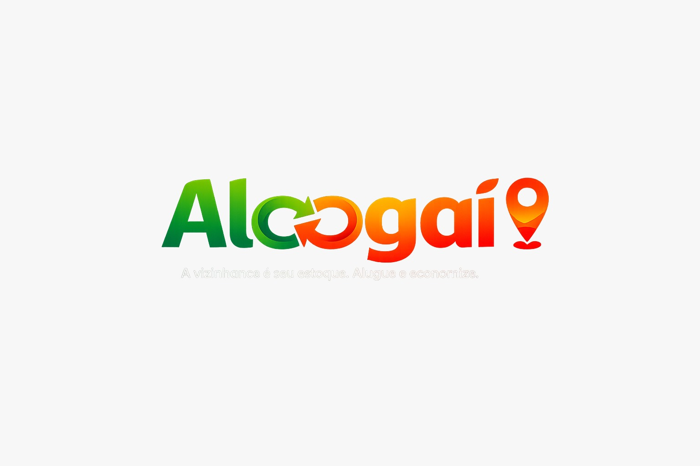

<div align="center">
  
  <h1>Aloogaí</h1>
  <p><b>A vizinhança é seu estoque. Alugue e economize.</b></p>
  <p><i>Marketplace P2P/B2B de Locação por Proximidade e Economia Circular</i></p>

  [](https://reactnative.dev/)
  [](https://www.djangoproject.com/)
  [](https://www.postgresql.org/)
  [](https://stripe.com)
</div>

<br>

## 🚀 Sobre o Projeto

O **Aloogaí** é uma plataforma inovadora baseada na economia circular que permite às pessoas (P2P) e empresas (B2B) alugar itens do dia a dia (ferramentas, equipamentos de camping, eletrônicos) direto com vizinhos e comércios locais. O aplicativo funciona exibindo itens disponíveis baseados na **geolocalização e raio de distância**, criando um ecossistema sustentável que economiza dinheiro, tempo e reduz a emissão de CO₂ gerada pelo consumismo excessivo.

## 🌟 Principais Funcionalidades

- 📍 **Busca Geoespacial Avançada:** Encontre os itens mais próximos de você em um mapa interativo ou feed dinâmico usando cálculos espaciais via **PostGIS**.
- 💳 **Split de Pagamentos & Caução Digital:** Integração nativa com **Stripe Connect** retendo cauções como pré-autorização (sem cobrar na hora) e dividindo a comissão do app (15% locador / 10% locatário) de maneira transparente.
- 💬 **Chat em Tempo Real:** Negocie as entregas e devoluções através de um chat seguro de ponta a ponta construído com **WebSockets** via Django Channels e Redis.
- 🌱 **Score ESG e Gamificação:** O app calcula a estimativa de CO₂ poupado ao alugar um item em vez de comprá-lo novo, convertendo isso num "Score de Impacto Positivo" exibido no perfil do usuário.
- 🔒 **KYC Automatizado:** Fluxos de verificação de identidade e licenciamento segregando usuários comuns de "Locadores Pro".

## 🛠️ Stack Tecnológica (V.L.A.E.G.S)

**Mobile (Frontend):**
- React Native (TypeScript) + Expo
- React Navigation (Bottom Tabs + Fullscreen Modals)
- Zustand (Gerenciamento de Estado)
- React Query (Data Fetching & Cache)
- React Native Maps

**Backend (API Core):**
- Python 3.11 / Django 5.x
- Django REST Framework (DRF)
- Django Channels (WebSockets / ASGI)
- Celery + Redis (Processamento Assíncrono e Channel Layer)
- Autenticação via JWT (SimpleJWT)

**Banco de Dados & Infra:**
- PostgreSQL 16 com extensão **PostGIS 3.4** (Para funções como `ST_DWithin`)
- AWS S3 / Google Cloud Storage (Para assets)
- Railway / GCP Cloud Run (Deploy)

## 📱 Telas do Aplicativo

*(Em breve: Adicionaremos aqui GIFs e Screenshots das telas de Feed, Mapa, Perfil e Fluxo de Checkout em Dark Mode e Light Mode).*

## ⚙️ Como rodar o projeto localmente

### 1. Backend (Django)
```bash
cd backend
python -m venv venv
# Ative o venv:
# Windows: .\venv\Scripts\activate | Mac/Linux: source venv/bin/activate
pip install -r requirements/dev.txt

# Copie o .env e rode as migrations (necessário SQLite compatível com Spatialite ou PostgreSQL/PostGIS)
python manage.py migrate
python manage.py runserver
```

### 2. Frontend (React Native / Expo)
```bash
cd mobile
npm install
npx expo start
```
*Utilize o aplicativo **Expo Go** no seu celular para ler o QR Code ou utilize um emulador Android/iOS.*

---

<div align="center">
  <i>Construído com código limpo, arquitetura escalável e foco na experiência do usuário.</i><br>
  Desenvolvido sob o protocolo V.L.A.E.G.S para o ecossistema brasileiro.
</div>
